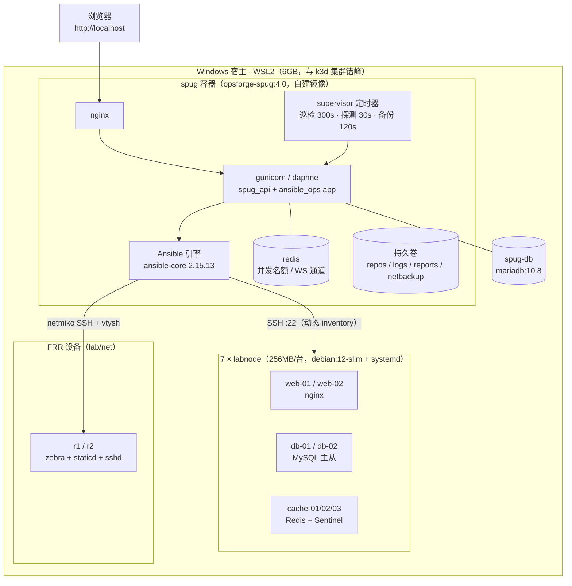

<h1 align="center">OpsForge</h1>

<div align="center">

基于 [openspug/spug](https://github.com/openspug/spug) v4.0.1 二次开发的多节点自动化运维平台实验环境：
在保留上游主机管理、批量执行、在线终端、应用发布等能力的基础上，新增 **Ansible 执行引擎、Playbook 版本化、批量巡检报表、告警闭环自愈、网络探测与设备备份** 五个自动化运维模块。

</div>

> **二开声明**：本项目基于开源项目 [Spug](https://github.com/openspug/spug)（AGPL-3.0）二次开发，
> 保留上游版权与许可；二开部分集中在 [`spug_api/apps/ansible_ops`](spug_api/apps/ansible_ops)（后端 app）、
> [`lab/web-overlay`](lab/web-overlay)（前端页面）与 [`lab/`](lab)（实验环境）。
> 完整运行手册见 [docs/opsforge/RUNBOOK.md](docs/opsforge/RUNBOOK.md)。

## 架构

平台层 = 上游 Spug 官方构建文件 + 自建镜像 `opsforge-spug:4.0`（内置 ansible-core 2.15.13、二开代码与前端产物）；
被管层 = 容器模拟的 7 台"真机"（systemd + sshd）+ 2 台 FRR 网络设备，全部接入同一 Docker 网络，预算跑在 6GB 的 WSL2 里。
目录：`spug_api/`（后端）· `lab/`（镜像构建 / 节点与网络环境 / Playbook 库 / 脚本）· `docs/opsforge/`（文档）· `tests/acceptance/`（验收套件）。



上游链路（主机纳管 / 批量执行 / 在线终端 / 应用发布）原样保留；二开模块全部挂在
`ansible_ops` app 下，经 nginx 同一 `/api/` 前缀与平台 token 鉴权（详见 [RUNBOOK](docs/opsforge/RUNBOOK.md)）。

## 能力与实测

> 每格可溯源——experiments/ 记录或 RUNBOOK 章节，汇总见 [summary.json](docs/opsforge/experiments/summary.json)。

| 模块               | 能力                                                                     | 实测                                                                                                              |
| ------------------ | ------------------------------------------------------------------------ | ----------------------------------------------------------------------------------------------------------------- |
| **执行引擎**       | 动态 inventory、redis 并发名额（上限 2）、WebSocket 实时回传、运行中终止 | 7 节点批量执行 7/7（**1.0s**）；kill 3s 内终态                                                                    |
| **Playbook 管理**  | 平台内编辑、保存前 syntax-check、git 版本化（diff 可见）、一键回滚       | commit 作者=操作人；回滚字节级回退                                                                                |
| **Playbook 库**    | MySQL 主从 / Redis 哨兵 / nginx / baseline 四册，幂等可重复              | 主从一键 **35s**；二跑全 changed=0；哨兵 failover 切换 1.1s                                                       |
| **巡检报表**       | 7 节点 42 检项采集、HTML+Excel+与上轮 diff、supervisor 定时轮            | 单轮 1–2s；3 类故障 5 crit 检出、恢复轮 diff（验收 e02）                                                          |
| **告警自愈**       | post_save(Alarm) 零侵入挂点、三道防风暴闸、钉钉/企微外发                 | 端到端 **30s**（闭环 3.2s）；走查复现 57s                                                                         |
| **网络探测与备份** | ICMP+TCP 矩阵、断链状态机告警、netmiko 备份与变更审计                    | 探测矩阵 **20/20**；断链检出 69s / 变更检出 22s                                                                   |
| **平台与实验环境** | 上游能力原样保留；7 节点 + 2 FRR 容器化靶场                              | 从零重建（`down -v`）**平台 25s / 含演示态 90s**；总内存 ≈**1.10 GiB**（预算 4.5GB）                              |
| **质量**           | 142 单测 + 31 条真实浏览器验收（Playwright）                             | **142 passed / 31 passed**（记录：[2026-10-02-full-replay](docs/opsforge/experiments/2026-10-02-full-replay.md)） |

## 快速开始

> 前置：Docker Desktop（WSL2 后端）+ 约 4GB 可用内存；宿主 80 端口空闲。命令在 Windows Git Bash / Linux 实测可跑。

```bash
git clone https://github.com/Rain-edge/OpsForge.git && cd OpsForge

# 1) 启动平台（首次构建镜像 opsforge-spug:4.0：构建期拉 v4.0.1 源码 + CDN 前端包）
docker compose -f docs/docker/docker-compose.yml -f docker-compose.override.yml up -d --build
# 空库首次初始化要十几秒，等 DB 就绪再 init（不等会报 (2002, ... on 'db' (115))）
until docker exec spug-db sh -c 'mysqladmin ping -uroot -pspug.cc 2>/dev/null' | grep -q alive; do sleep 2; done
docker exec spug init_spug admin spug.cc      # 建表 + 管理员（本地实验默认值，勿用于公网）

# 2) 起 7 台被管节点并纳管（.env 默认口令 Opsforge.lab；重跑去掉 --build 避免重建节点）
cd lab/nodes && cp .env.example .env && docker compose up -d --build && cd ../..
bash lab/scripts/register_hosts.sh            # 建 web/db/cache 分组 + 分发平台公钥，幂等

# 3) Playbook 入库；可选：网络设备 / 自愈演示环境 / 演示态（跑验收或手工演示前执行）
bash lab/scripts/import_playbooks.sh
docker compose -f lab/net/docker-compose.yml up -d --build
bash lab/scripts/setup_heal_demo.sh && bash lab/scripts/setup_demo_state.sh

# 4) 浏览器打开 http://localhost（admin / spug.cc）
```

登录后可验证：主机管理页应有 7 台已验证主机；「Ansible 自动化」菜单下有执行 / Playbook / 巡检 / 网络探测页面。
停止/重置、API 一览与各模块排查路径见 [RUNBOOK](docs/opsforge/RUNBOOK.md)。

## 二开统计

`python scripts/oss-diff.py`（基线 `upstream/master...HEAD`）按目录聚合：

| 口径                                                                                     |    文件 |      新增 |    删除 |
| ---------------------------------------------------------------------------------------- | ------: | --------: | ------: |
| **二开小计**（后端 / 前端 / Playbook 库 / 镜像构建 / 实验环境 / 脚本 / 验收套件 / 文档） | **141** | **12216** |       0 |
| └ docs/docker ×8（上游 v4.0.1 原件恢复，不计工作量）                                     |       8 |      1341 |       0 |
| **合计**（含 README/配置等杂项 10 文件）                                                  | **159** | **13906** | **118** |

README 重写替换上游原版，是唯一的 118 行删除；`spug_api/` 其余部分与上游基线一致（仅新增 `pytest.ini` 与 `test_settings.py`）。

## 文档

- [RUNBOOK](docs/opsforge/RUNBOOK.md) — 从零启动到各模块排查路径的运行手册（含踩坑清单）
- [ADR](docs/opsforge/adr) — 关键设计决策记录：[0001 基线运行形态](docs/opsforge/adr/0001-baseline-and-run-form.md) · [0002 节点实验环境](docs/opsforge/adr/0002-labnode-systemd-and-network.md) · [0003 为何二开而非自研](docs/opsforge/adr/0003-why-fork-spug.md) · [0004 为何自建执行引擎](docs/opsforge/adr/0004-custom-ansible-engine.md) · [0005 网络设备模拟](docs/opsforge/adr/0005-network-device-simulation.md)
- [experiments](docs/opsforge/experiments) — 实验原始记录（命令 + 完整输出 + 结论）与 [summary.json](docs/opsforge/experiments/summary.json) 汇总

## License & Copyright

- 本项目遵循 [AGPL-3.0](LICENSE) 许可证；上游项目 [Spug](https://github.com/openspug/spug) 版权归其原作者所有，感谢开源。
- 二开部分（`spug_api/apps/ansible_ops`、`lab/`、`docs/opsforge/`）同样以 AGPL-3.0 发布。
